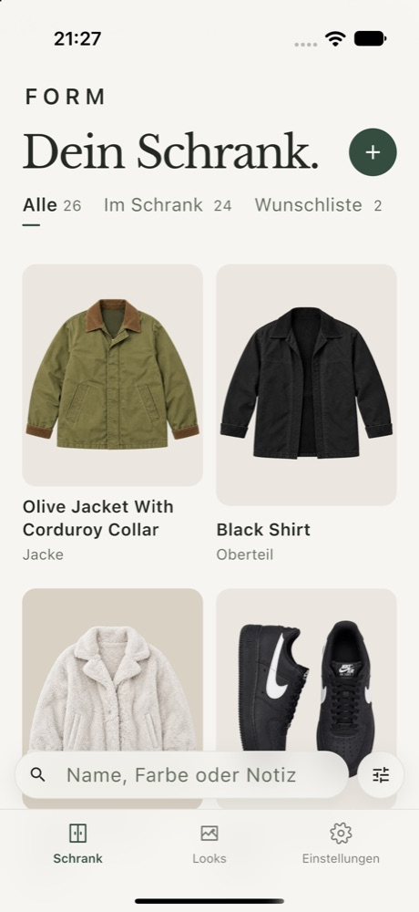
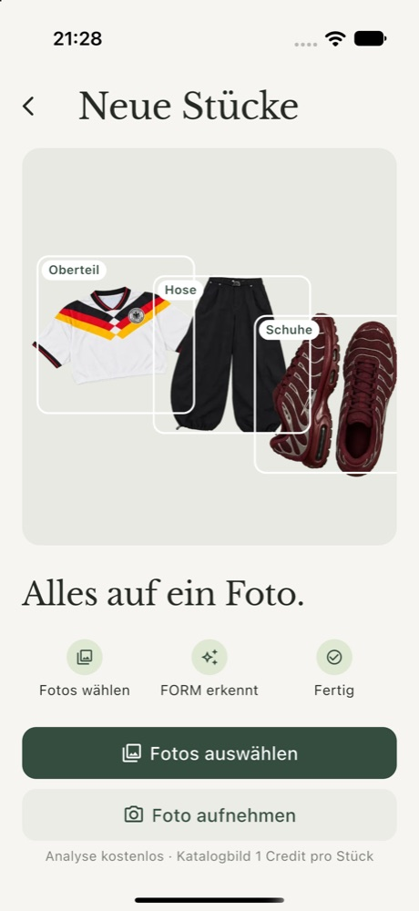
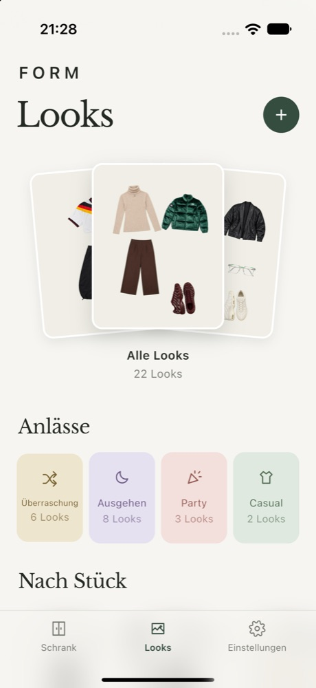

<p align="center">
  
</p>

<h1 align="center">FORM</h1>

<p align="center">
  Your wardrobe, clean and on your phone.<br>
  Photograph your clothes, get a tidy catalog, and build looks from what you already own.
</p>

<p align="center">
  
  &nbsp;
  
  &nbsp;
  
</p>

## What it does

- **Wardrobe.** Every piece gets a clean catalog image, a name, a category and its colors. Owned, wishlist and archive live side by side and are searchable.
- **Intake.** One photo can hold several pieces. FORM detects them, proposes metadata and you confirm. Detection is free, a catalog image costs one credit per piece.
- **Looks.** Combinations of your own pieces, grouped by occasion and by piece. AI images are an optional extra. Nothing in the wardrobe depends on them.

The clean catalog is the core of the product. See [`apps/mobile/PRODUCT.md`](apps/mobile/PRODUCT.md) for the product direction and [`CONTEXT.md`](CONTEXT.md) for the domain language.

## Repository

| Path | What |
| --- | --- |
| `apps/mobile` | Flutter app for iOS, shipped via TestFlight. Bloc, go_router, easy_localization |
| `apps/api` | Hono API |
| `apps/worker` | Background worker for detection and image generation |
| `packages/service` | Domain logic, Postgres migrations, CLIs |
| `packages/contracts` | Shared API contracts |
| `deploy` | Ship, backup and restore scripts, nginx config, and the public privacy policy |

Accounts sign in with Apple, Google or email and password. Usage is metered in credits. Details in [`docs/accounts-and-billing.md`](docs/accounts-and-billing.md).

## Local development

Node.js 24, Docker, and `fvm` for Flutter.

```sh
npm ci
cp .env.services.example .env.services.local
cp apps/api/.env.example apps/api/.env.local
npm run services:up              # Postgres (:55432) and MinIO
npm run services:migrate
npm run dev:production           # api and worker together
npm run dev:seed                 # optional: a dev account with ready pieces
```

The mobile app runs against that API:

```sh
cd apps/mobile
fvm flutter pub get
cp .env.example .env.development.json   # set FORM_API_BASE_URL
fvm flutter run --flavor development --dart-define-from-file=.env.development.json
```

More in [`apps/mobile/README.md`](apps/mobile/README.md).

### Two databases

| Database | Used by | Safe to reset |
| --- | --- | --- |
| `form` | `npm run dev:*` via `apps/api/.env.local` | No, this is your dev wardrobe |
| `form_fixtures` | integration tests and `fixtures:reset` via `.env.services.local` | Yes |

`resetFixtures` truncates every table and refuses any database whose name does not end in `_fixtures`. A fresh checkout creates the fixture database once:

```sh
docker compose exec postgres createdb -U form form_fixtures
```

## Checks

```sh
npm run verify                   # unit and contract checks for all workspaces
npm run verify:mobile            # flutter analyze and flutter test
npm run test:integration         # against form_fixtures
```

[`AGENTS.md`](AGENTS.md) says which check fits which change.

## Releases

| Target | How | Docs |
| --- | --- | --- |
| Backend on stargate | `deploy/ship.sh` (all) or `deploy/ship.sh api worker` | [`docs/public-access.md`](docs/public-access.md) |
| iOS TestFlight | `npm run release:testflight -- --build-number N` | [`docs/testflight.md`](docs/testflight.md) |
| Production backups | nightly via cron on stargate, `deploy/backup-nightly.sh` | [`docs/backups.md`](docs/backups.md) |

`ship.sh` stamps `FORM_VERSION` and waits until `/version.json` reports it. Calling Compose directly bakes `dev` into the image, and the deploy can't be confirmed.
